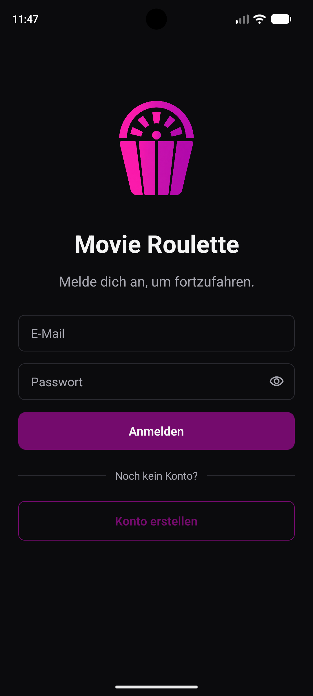
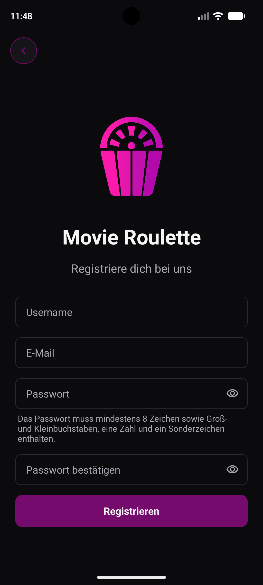

# Movie Roulette App

[](https://github.com/ChristophVorer/movie-roulette-app/actions/workflows/ci.yml)

React Native and Expo mobile app for discovering movies, powered by the custom [Movie Roulette API](https://github.com/ChristophVorer/movie-roulette-api) built with Spring Boot.

> **Status:** in active development. Registration and login are complete; the home screen with movie discovery is next.

<p align="center">
  
  &nbsp;&nbsp;
  
</p>

## Features

- Registration and login against the Movie Roulette API
- Field-level validation errors from the backend shown directly at the affected input
- Password visibility toggle and password requirements hint
- File-based navigation with Expo Router
- Dark theme with a consistent set of reusable components

## Tech stack

- **Expo SDK 57**, **React Native 0.86**, **React 19**, **TypeScript**
- **Expo Router** for file-based navigation
- **Expo Development Build** (`expo-dev-client`)
- **Jest** with `jest-expo` and **React Native Testing Library**
- **ESLint**, **Prettier**, **GitHub Actions**, **Dependabot**

## Getting started

### Prerequisites

- Node.js 22 (see `.nvmrc`)
- Android Studio with an Android emulator, or an Android device
- The [Movie Roulette API](https://github.com/ChristophVorer/movie-roulette-api) running locally

> The app is currently developed and tested on Android only.

### Run locally

```bash
git clone https://github.com/ChristophVorer/movie-roulette-app.git
cd movie-roulette-app
npm ci
cp .env.example .env
npx expo run:android
```

### API URL

The backend URL is configured in `.env`:

```bash
EXPO_PUBLIC_API_URL=http://10.0.2.2:8080/api
```

`10.0.2.2` is how the Android emulator reaches `localhost` on your computer. On a physical device, use your computer's local network IP instead, e.g. `http://192.168.0.10:8080/api`.

### Quality checks

```bash
npm run lint          # ESLint
npm run format:check  # Prettier
npm run typecheck     # TypeScript
npm test              # Jest
```

## Architecture

```
src
├── app          # Screens and routes (Expo Router, file-based)
├── api          # API client, error handling and endpoint functions
├── components   # Reusable UI components (MR* prefix)
├── theme        # Colors and shared design values
└── types        # Shared TypeScript types for API and auth
```

Screens never call `fetch` directly. All requests go through `apiClient`, and endpoint functions such as `login` and `register` in `authApi` provide a typed interface for the screens.

## Design decisions

**Thin, typed `fetch` wrapper instead of a HTTP library.**
`apiClient` adds the base URL and JSON headers, parses responses and turns error responses into an `ApiError`. This covers everything the app needs without an extra dependency like Axios, and the generic return type keeps responses typed at the call site.

**Error handling based on RFC 9457 Problem Details.**
The API returns errors as Problem Details, so `ApiError` carries the parsed problem along with the HTTP status. The type guard `isValidationProblem` detects field-level validation errors, which the forms show directly at the affected inputs. Backend and app share one error format instead of ad-hoc messages.

**Fail fast on missing configuration.**
The app throws on startup if `EXPO_PUBLIC_API_URL` is not set, instead of failing later with unclear network errors. Note that `EXPO_PUBLIC_` variables are embedded in the app bundle, so they must never contain secrets.

**Reusable, accessible components.**
Buttons and inputs are shared components with a common `MR` prefix. Icon-only buttons, such as the back button and the password visibility toggle, have accessibility labels so screen readers can announce them.

## Testing

- **Jest** with the `jest-expo` preset and **React Native Testing Library**
- Tests live next to the code they test, outside `src/app`, since Expo Router treats every file there as a route
- **API layer:** `fetch` is mocked, so tests cover request building, response parsing and error handling without a running backend
- **Components:** tested from the user's perspective, by visible text and accessible roles, rather than implementation details or styling

## CI

Every pull request and push to `main` runs lint, format check, typecheck, `expo-doctor` and all tests on GitHub Actions. Merging into `main` requires a green build.

Dependabot keeps GitHub Actions and npm dependencies up to date. Packages whose versions are tied to the Expo SDK are excluded and updated together via `npx expo install --fix`, so they stay compatible.

## Roadmap

- Home screen with popular movies
- Movie details
- More movie lists from the API (e.g. top rated, upcoming)
- Personal watchlists
- Movie roulette: random movie suggestions from personal watchlists or predefined lists such as popular or top rated movies
- Pull request previews with EAS Update
- Testing on iOS

## License

All rights reserved. See [LICENSE](LICENSE) for details.
